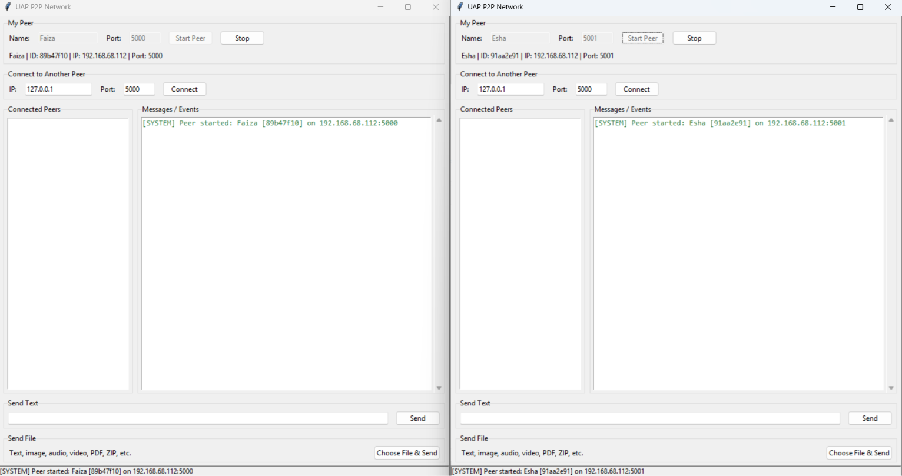
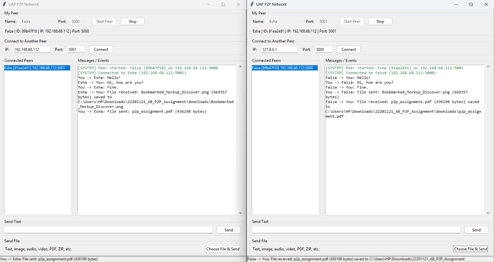
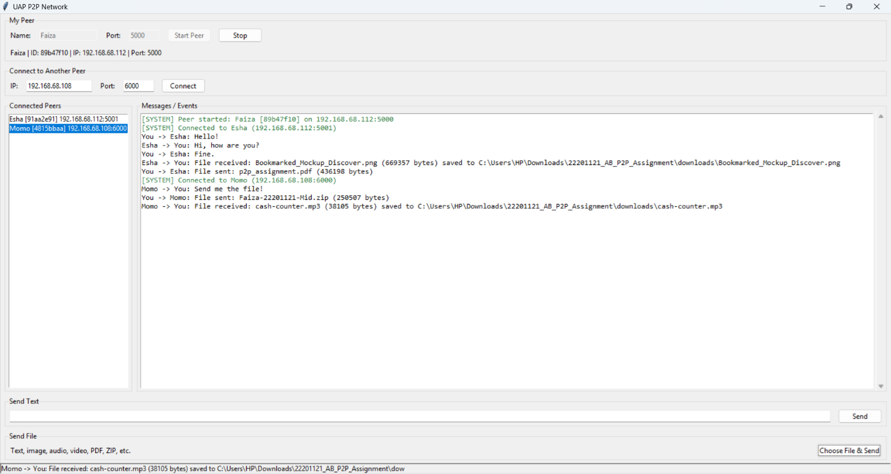
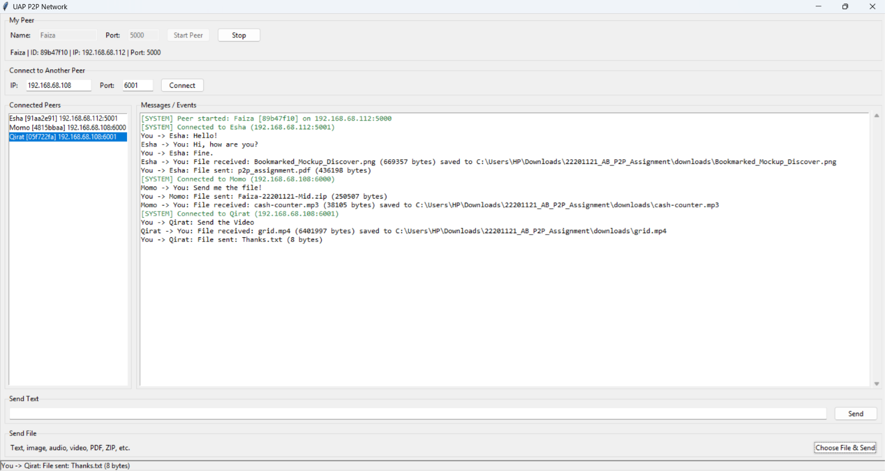
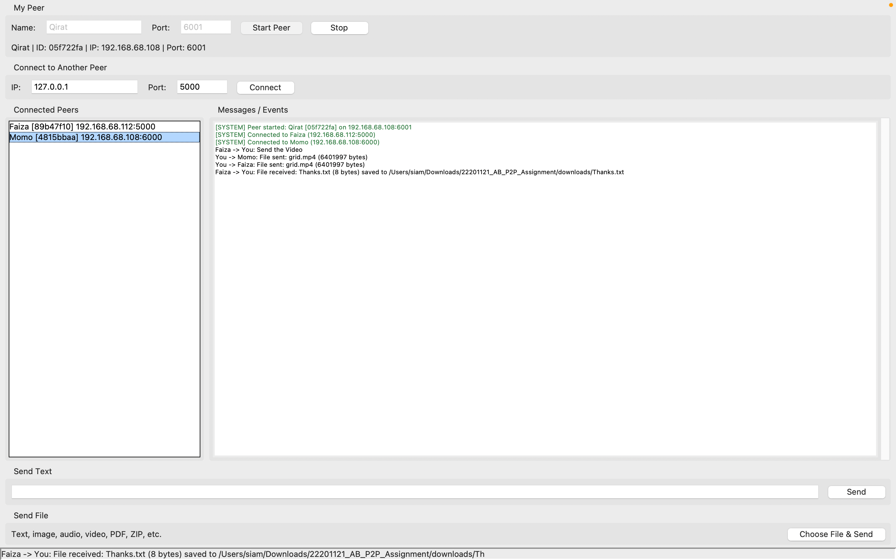
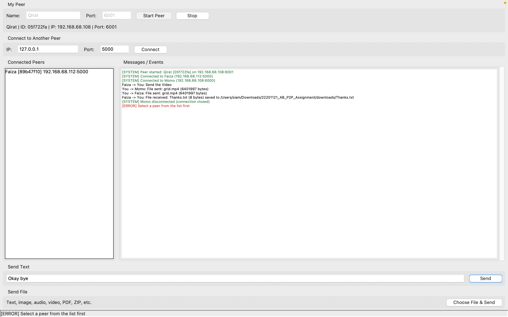

# Peer-to-Peer Network Communication and File Sharing

**University:** University of Asia Pacific, Department of Computer Science and Engineering  
**Course:** CSE 433 – Blockchain & Distributed Security Lab  
**Assignment:** Peer-to-Peer Network Communication and File Sharing  
**Student:** Faiza Ahmed Esha  
**Student ID:** 22201121  
**Section:** AB  
**Language:** Python

## 1. Project Overview

This project is a Python-based peer-to-peer (P2P) application for direct communication and file sharing over TCP connections. Each running application instance acts as a peer. Peers can connect using an IP address and port, exchange text messages, and transfer files.

## 2. Requirements

- Python 3 with Tkinter support
- A desktop environment
- For communication between computers, both devices must be reachable over the same local network, and the required connections must be allowed by the firewall

No third-party Python packages are required.

## 3. Project Structure

```text
22201121_AB_P2P_Assignment/
├── main.py          # Graphical user interface
├── p2p_node.py      # Peer connections, messaging, and file transfer
├── protocol.py      # Message formatting and parsing
├── requirements.txt
├── README.md
├── downloads/       # Received files
└── screenshots/     # Assignment screenshots
```

## 4. Setup and Execution

1. Extract the project ZIP file.
2. Open a terminal in the project folder.
3. Check that Python is installed:

   ```bash
   python --version
   ```

4. Run the application:

   ```bash
   python main.py
   ```

To run multiple peers on one computer, open a separate terminal for each instance and assign a different listening port to each peer.

## 5. Connecting and Using Peers

1. Enter a peer name and an available listening port, then start the peer.
2. To connect to another peer, enter its IP address and listening port, then select **Connect**.
3. Select the connected peer before sending a text message or file.
4. To send a file, choose the file-transfer option and select the file. Received files are saved in the `downloads/` folder.

For peers on the same computer, use the other peer's local address and port. For peers on different computers, use the receiving computer's LAN IP address and the peer's listening port.

## 6. Testing Setup

The application was tested on two physical devices connected through the local network:

| Device | Operating system | Peer | Port |
|---|---|---|---:|
| Device 1 | Windows | Faiza | 5000 |
| Device 1 | Windows | Esha | 5001 |
| Device 2 | macOS | Momo | 6000 |
| Device 2 | macOS | Qirat | 6001 |

The screenshots show selected stages of local testing, peer connections, text communication, file-transfer activity, and communication across the two devices. The screenshots represent different testing stages and do not necessarily show all peers running simultaneously.

## 7. Screenshots

The following screenshots show peer startup, text messaging, file transfer, and multi-peer communication.

### 7.1 Peer Startup



### 7.2 Local Text Messaging and File Transfer



### 7.3 Multi-Peer Connections and Audio Transfer



### 7.4 Four-Peer Network



### 7.5 Cross-Device Communication



## 8. Error Handling

The application displays an error message when a send action is attempted without selecting a connected peer.



## 9. Scope

This project focuses on peer-to-peer networking, TCP connections, text messaging, file transfer, and communication between multiple peers. It does not implement a blockchain or cryptocurrency.
